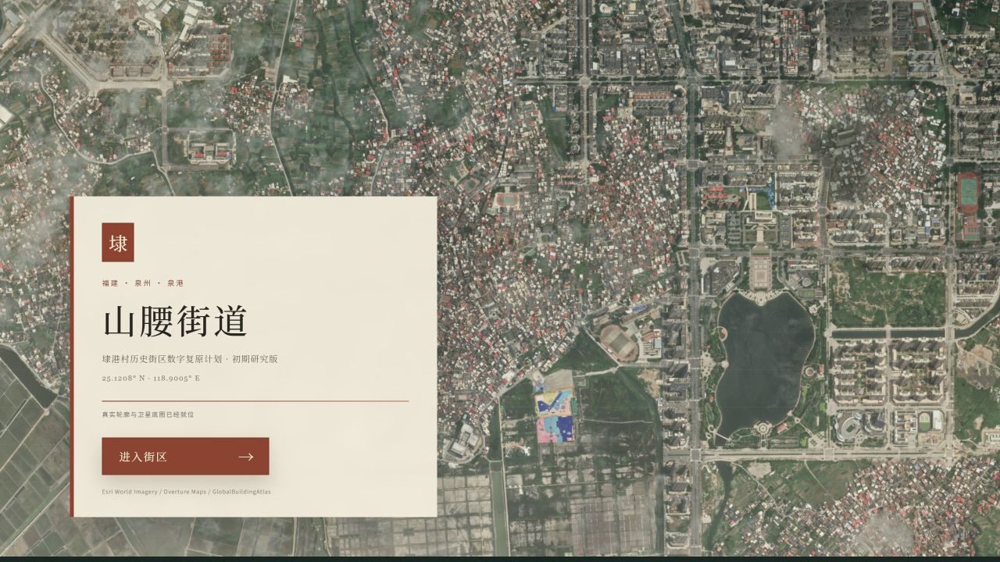
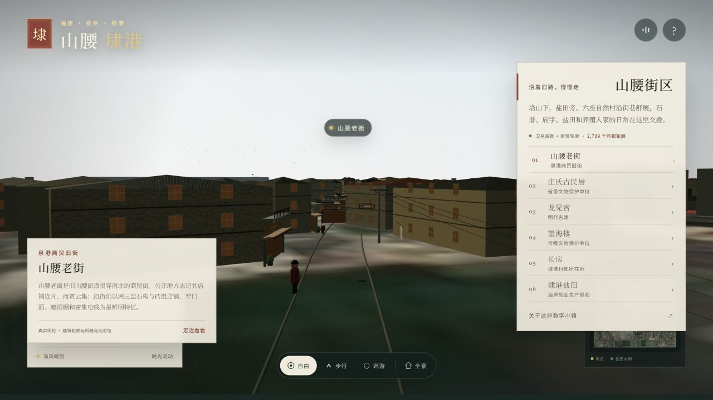

# Shanyao–Daigang 3D Reconstruction

> **Status: very early prototype.** This is not a finished digital twin and it is nowhere near a verified 1:1 reconstruction. The long-term goal is to build an evidence-based, street-by-street reconstruction of Shanyao Street (山腰街道), with Daigang Village (埭港村) and the old commercial street as the first study area. The project will continue to improve gradually.

[GitHub repository](https://github.com/ZhuangHT-1201/shanyao-daigang-3d)



## Why this project exists

Shanyao–Daigang is a coastal settlement in Quangang District, Quanzhou, Fujian. Its older streets combine dense low-rise shopfronts, masonry and plaster buildings, temples, salt fields, farmland, and a strong everyday street culture. Much of this spatial knowledge is scattered across maps, satellite imagery, local records, and personal memory rather than one authoritative 3D dataset.

This repository is an exploratory attempt to bring those sources into a single spatial scene:

- real satellite imagery registered to WGS84 coordinates;
- building footprints and estimated heights;
- traced road centrelines and named streets;
- verified heritage locations and local history;
- an interactive 3D environment for orientation, walking, and future research.

It is intentionally public at an incomplete stage so that better source material, local knowledge, and technical improvements can be incorporated over time.

## Current scope

The present scene focuses on the continuous urban corridor from **Shanyao Old Street to Daigang Village**, within an approximately 4 × 4 km imagery envelope. It does **not** yet cover the full 33.6 km² administrative area of Shanyao Subdistrict.

Current viewpoints include:

- Shanyao Old Street (山腰老街)
- Zhuang Family Historic Houses / Xiaosanfang (庄氏古民居·小三房)
- Longjiangong (龙见宫)
- Wanghai Tower (望海楼)
- Changfang (长房)
- Shanyao Salt Field – Daigang work area (山腰盐场·埭港工区)

## Current implementation

- **2,205 Overture building footprints** for the main study area.
- **515 GlobalBuildingAtlas fallback footprints** where Overture coverage is sparse.
- **2,709 footprints rendered as individual-scale 3D buildings.** Eleven oversized aggregate polygons are left as satellite imagery rather than extruded into false megastructures.
- Building heights use nearby GlobalBuildingAtlas machine estimates where available; remaining heights are conservative area-based estimates.
- A WGS84-registered satellite basemap provides roads, yards, fields, roof colours, salt-field patterns, and the wider settlement context.
- A higher-resolution old-street image patch is blended into the base map.
- Roof colour is sampled from the georeferenced imagery, while tile and concrete patterns are rendered as separate materials. This avoids stretching street and neighbour pixels across sloped roofs.
- Street-level reconstruction includes shop signs, shutters, awnings, balconies, utility poles, overhead wires, drains, planters, parked scooters, moving pedestrians, and wind-blown laundry.
- The minimap uses the real satellite image and labels known road names.
- The orbit camera supports free rotation, zoom, and right-button panning. After nine seconds without input it drifts slowly around the current target; any interaction stops the drift. Reduced-motion preferences disable that drift.



## One-click launch on Windows

Requirements: Node.js 20 or newer.

1. Double-click `启动山腰.cmd`.
2. Wait for the scene to finish loading.
3. Click **进入街区** (Enter the district).

The launcher installs dependencies on first use, starts the local Vite server, and opens the app in the default browser.

Manual launch:

```powershell
npm install
npm run start
```

Development and production builds:

```powershell
npm run dev
npm run build
npm run preview
```

## Satellite imagery is not redistributed

The Esri World Imagery tiles used for local visual verification are **not committed to this repository by default** because map-provider terms are separate from the source-code licence.

The app still starts without those images and falls back to procedural terrain and materials. To reproduce the full local visual reference:

```powershell
python -m pip install requests pillow
python tools/satellite_reference.py --provider esri --zoom 17 --radius-tiles 7 --output research/daigang_satellite_z17_esri.jpg
python tools/satellite_reference.py --provider esri --zoom 18 --radius-tiles 5 --output research/oldstreet_satellite_z18_esri.jpg
python tools/prepare_satellite_assets.py
```

Review the provider's licence before any public deployment or commercial distribution. Screenshots in this README include map imagery only as project documentation.

## Controls

- Drag to orbit; use the mouse wheel to zoom.
- Select a place from the right-hand panel to fly to it.
- Choose **步行** (Walk), then click the scene to lock the pointer.
- Use `WASD` or arrow keys to move and `Shift` to move faster.
- Press `1`–`6` to visit the six current places.
- Drag to rotate, scroll to zoom, and right-drag to pan. The camera also drifts slowly after a period of inactivity.
- Press `N` for day/night, `R` for clear/rain, and `O` for the overview.
- Use the timeline to control time of day.
- Turn off **时光流动** to freeze the scene time.

## What is real and what is reconstructed

### Relatively well supported

- Administrative boundary context and the six natural villages, based on the 2021 Quangang District Government village profile.
- Heritage status of Zhuang Family Historic Houses, Wanghai Tower, Longjiangong, Shiqiao, and Houlou.
- Road names and approximate topology traced from public AMap imagery.
- Building footprints from Overture Maps and GlobalBuildingAtlas.
- Ground and salt-field patterns visible in satellite imagery.
- Old-street shop names recorded in public AMap search results on 2026-11-11.

### Interpreted or approximate

- Most facade materials, window placement, balconies, awnings, signs, and street furniture.
- Heights where no reliable nearby estimate exists.
- People, scooters, birds, lighting, weather, and ambient sound.
- The detailed architecture of heritage buildings.
- The exact dates at which satellite imagery and map POIs were captured.

### Not yet verified

- Individual building identities and current occupants.
- Exact shop openings, doors, roof pitches, and rear elevations.
- Current conservation boundaries and public-access restrictions.
- Survey-grade road widths, elevation, drainage, utilities, and fire access.

Do not use this project for navigation, cadastral decisions, construction, emergency planning, or authoritative heritage documentation.

## Data and attribution

- [Quangang District Government – Shanyao Subdistrict profile](https://www.qg.gov.cn/zwgk/zfjg/202103/t20210323_2528559.htm)
- [Overture Maps Foundation](https://overturemaps.org/download/), buildings release 2026-10-21.0.
- [East Asian Buildings](https://doi.org/10.5281/zenodo.8174931), CC BY 4.0.
- [GlobalBuildingAtlas](https://github.com/zhu-xlab/GlobalBuildingAtlas), polygons and machine-estimated heights, CC BY-NC 4.0.
- [OpenStreetMap contributors](https://www.openstreetmap.org/copyright), ODbL where applicable.
- [Esri World Imagery](https://www.esri.com/en-us/arcgis/products/arcgis-world-imagery/overview), local visual reference only; check provider terms before redistribution.

Detailed evidence notes are kept locally in `research/SOURCES.md`, which is excluded from the public repository along with the large raw research archive.

## Project structure

```text
src/
  config.js           locations, roads, cameras, and place descriptions
  world.js            scene assembly, georeferenced imagery, weather, and lights
  real-buildings.js   footprint extrusion, roof projection, and street details
  main.js             renderer, interaction, UI state, and minimap
  textures.js         procedural material textures
public/data/
  buildings_real.geojson
  buildings_overture.geojson
  buildings_oldstreet.geojson
tools/
  satellite_reference.py
  prepare_satellite_assets.py
  project_overture_to_local.mjs
```

## Roadmap

1. Collect licensed, rectified façade photographs for every building on the core old street.
2. Replace estimated heights and generic openings with measured floor levels and roof profiles.
3. Improve courtyard plans for the Zhuang historic houses and other heritage buildings.
4. Extend coverage beyond the current old-street/Daigang study area.
5. Add provenance metadata to individual buildings instead of one project-wide confidence note.
6. Record more oral histories, local shop histories, and everyday street uses.
7. Produce repeatable visual comparisons against survey photography.

The target remains a highly realistic reconstruction of Shanyao Street. Reaching anything close to 1:1 will require local fieldwork, measured drawings, licensed imagery, and continued iteration.

## Contributing

Corrections from people familiar with Shanyao, Daigang, local heritage, archives, or geospatial reconstruction are especially welcome. Please include a source, date, and location whenever possible.

This is an early-stage project, so issues, reproducible bug reports, source links, and small focused pull requests are more useful than large speculative rewrites.

## License

Source code is released under the [MIT License](LICENSE). Third-party map data, imagery, and screenshots may use different licences; see [DATA_LICENSES.md](DATA_LICENSES.md).
